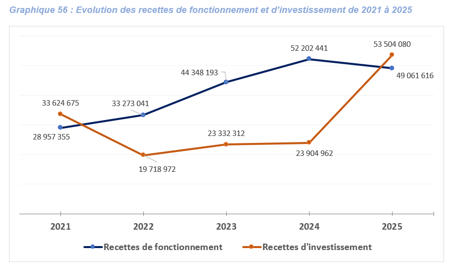

<!-- Document autonome : graphiques SVG intégrés, sans CSV ni package R requis.
Rendu : quarto render synthese_revealjs_actualisee.qmd --to revealjs
Navigation : flèches ; O = vue d'ensemble ; S = notes ; F = plein écran.
Les graphiques reprennent les chiffres explicitement écrits dans la synthèse actualisée et le mémoire.
Les résultats administratifs, cartographiques et déclaratifs sont distingués.
Auteur à renseigner dans le YAML avant diffusion. Date à adapter à celle de l’atelier.
Les pourcentages restent ceux publiés, sans recalcul à partir de données absentes.
-->


## Un diagnostic pour préparer les choix du PDC

::: {.incremental}

- Disposer d’une connaissance partagée du territoire et des conditions de vie.
- Identifier les atouts, les disparités et les besoins prioritaires.
- Relier les constats aux capacités institutionnelles et financières de la commune.

:::
::: {.message}
**Objet de l’atelier :** examiner et consolider le diagnostic avant la programmation.
:::


## Méthodologie : une démarche participative et technique

| Source | Modalités de collecte |
|:--|:--|
| Documentation | RGPH-4 et 5, monographies, rapports sectoriels, documents de la mairie |
| Enquête ménages | **1 458 ménages** dans quatre zones géographiques |
| Concertation | **4 fora communautaires**, entretiens publics et privés |
| Observation spatiale | Observations de terrain, services techniques, Géoportail et images satellitaires |


## Milieu physique et population : un territoire jeune

::: {.description}
La position sur la RN1, les plaines agricoles, les bas-fonds et le patrimoine forestier constituent des atouts. Les reliefs montagneux limitent toutefois l’accessibilité de plusieurs localités. La jeunesse de la population accroît les besoins en éducation, en formation et en insertion.
:::

| Indicateur | Valeur rapportée |
|:--|:--|
| Superficie | 468 km² |
| Population en 2010 / 2022 | 20 768 / **24 891 habitants** |
| Croissance annuelle indiquée | 1,7 % |
| Population de moins de 20 ans | **53 %** |
| Femmes dans la population | 50,6 % |

::: {.message}
La RN1, les plaines et les bas-fonds sont des atouts. Les reliefs compliquent la desserte de certaines localités.
La commune couvre 468 km² et compte 24 891 habitants en 2022, contre 20 768 en 2010. Le rapport indique une croissance annuelle de 1,7 %. Les moins de 20 ans représentent 53 % de la population et les femmes 50,6 %. La position sur la RN1, les plaines agricoles, les bas-fonds et le patrimoine forestier constituent des atouts, mais les reliefs montagneux limitent l’accessibilité de plusieurs localités. La diversité socioculturelle s’accompagne d’un vivre-ensemble globalement favorable.
:::

## Milieu physique et population : enjeux prioritaires

::: {.incremental}

- Adapter les équipements à une population majoritairement jeune.
- Réduire les disparités d’accès entre localités de plaine et zones montagneuses.
- Valoriser la position sur la RN1 en préservant les ressources naturelles et la cohésion sociale.

:::

## Occupation du sol : progression du bâti et recul forestier

::: {.description}
L’espace communal s’organise autour de Lama-Tessi et de la RN1, avec des niveaux d’équipement variables. L’extension du bâti et le recul forestier appellent une maîtrise de l’occupation du sol. Le service de topographie constitue un appui, mais les réserves foncières restent à sécuriser.
:::

| Indicateur | 2000 | 2025 |
|:--|:--|:--|
| Espaces bâtis | 358,2 ha | **968,1 ha** |
| Part des espaces forestiers | 38,3 % | **24,6 %** |

::: {.message}
Le rapport estime le recul forestier à **6 405,1 ha** entre 2000 et 2025.

L’espace communal s’organise autour de Lama-Tessi et de la RN1, avec des niveaux d’équipement variables entre localités. Entre 2000 et 2025, les espaces bâtis passent de 358,2 à 968,1 ha, tandis que les forêts reculent de 6 405,1 ha. L’enquête indique que 85,4 % des réponses foncières interprétables signalent l’absence de document et que 89 % des répondants à la question du bornage n’ont pas de terrain officiellement délimité. La commune dispose d’un service de topographie, mais pas encore de réserves foncières formellement constituées et sécurisées.
:::

## Aménagement et foncier : sécurisation et réserves publiques à renforcer

::: {.description}
L’espace communal s’organise autour de Lama-Tessi et de la RN1, avec des niveaux d’équipement variables. L’extension du bâti et le recul forestier appellent une maîtrise de l’occupation du sol. Le service de topographie constitue un appui, mais les réserves foncières restent à sécuriser.
:::

```{=html}
<svg class="chart" xmlns="http://www.w3.org/2000/svg" viewBox="0 0 1100 249" role="img" aria-label="Sécurisation foncière"><title>Sécurisation foncière</title><line x1="420.0" y1="45" x2="420.0" y2="209" stroke="#29465e"/><text x="420.0" y="237" fill="#b7cadc" text-anchor="middle" font-family="Arial" font-size="20">0 %</text><line x1="562.5" y1="45" x2="562.5" y2="209" stroke="#29465e"/><text x="562.5" y="237" fill="#b7cadc" text-anchor="middle" font-family="Arial" font-size="20">25 %</text><line x1="705.0" y1="45" x2="705.0" y2="209" stroke="#29465e"/><text x="705.0" y="237" fill="#b7cadc" text-anchor="middle" font-family="Arial" font-size="20">50 %</text><line x1="847.5" y1="45" x2="847.5" y2="209" stroke="#29465e"/><text x="847.5" y="237" fill="#b7cadc" text-anchor="middle" font-family="Arial" font-size="20">75 %</text><line x1="990.0" y1="45" x2="990.0" y2="209" stroke="#29465e"/><text x="990.0" y="237" fill="#b7cadc" text-anchor="middle" font-family="Arial" font-size="20">100 %</text><text x="400" y="85" fill="#edf3fa" text-anchor="end" font-family="Arial" font-size="23">Absence de document foncier</text><rect x="420" y="60" width="486.78000000000003" height="34" rx="3" fill="#4ecbd3"/><text x="916.78" y="85" fill="#ffffff" font-family="Arial" font-size="23" font-weight="bold">85,4 %</text><text x="400" y="152" fill="#edf3fa" text-anchor="end" font-family="Arial" font-size="23">Terrain sans bornage officiel</text><rect x="420" y="127" width="507.3" height="34" rx="3" fill="#4ecbd3"/><text x="937.3" y="152" fill="#ffffff" font-family="Arial" font-size="23" font-weight="bold">89,0 %</text></svg>
```

::: {.message}
Articuler le PDC avec le SDAU, sécuriser les emprises et constituer des réserves géoréférencées.

L’espace communal s’organise autour de Lama-Tessi et de la RN1, avec des niveaux d’équipement variables entre localités. Entre 2000 et 2025, les espaces bâtis passent de 358,2 à 968,1 ha, tandis que les forêts reculent de 6 405,1 ha. L’enquête indique que 85,4 % des réponses foncières interprétables signalent l’absence de document et que 89 % des répondants à la question du bornage n’ont pas de terrain officiellement délimité. La commune dispose d’un service de topographie, mais pas encore de réserves foncières formellement constituées et sécurisées.
:::

## Aménagement et foncier : enjeux prioritaires

::: {.incremental}

- Articuler le PDC avec le SDAU en cours d’élaboration pour maîtriser l’occupation du sol.
- Sécuriser les droits fonciers, les emprises publiques et les terrains destinés aux équipements.
- Prévenir les conflits et organiser un inventaire géoréférencé des réserves foncières.
- Répartir les services de manière équilibrée et améliorer l’habitat, notamment sa résistance aux pluies et son drainage.

:::

## Profil des ménages : des besoins à cibler

::: {.description}
Les charges familiales et les ressources limitées se cumulent et fragilisent les ménages. Les écarts d’instruction entre femmes et hommes appellent des interventions différenciées, attentives aux enfants, aux jeunes et aux personnes les plus vulnérables.
:::

```{=html}
<svg class="chart" xmlns="http://www.w3.org/2000/svg" viewBox="0 0 1100 249" role="img" aria-label="Sexe des chefs de ménage"><title>Sexe des chefs de ménage</title><line x1="420.0" y1="45" x2="420.0" y2="209" stroke="#29465e"/><text x="420.0" y="237" fill="#b7cadc" text-anchor="middle" font-family="Arial" font-size="20">0 %</text><line x1="562.5" y1="45" x2="562.5" y2="209" stroke="#29465e"/><text x="562.5" y="237" fill="#b7cadc" text-anchor="middle" font-family="Arial" font-size="20">25 %</text><line x1="705.0" y1="45" x2="705.0" y2="209" stroke="#29465e"/><text x="705.0" y="237" fill="#b7cadc" text-anchor="middle" font-family="Arial" font-size="20">50 %</text><line x1="847.5" y1="45" x2="847.5" y2="209" stroke="#29465e"/><text x="847.5" y="237" fill="#b7cadc" text-anchor="middle" font-family="Arial" font-size="20">75 %</text><line x1="990.0" y1="45" x2="990.0" y2="209" stroke="#29465e"/><text x="990.0" y="237" fill="#b7cadc" text-anchor="middle" font-family="Arial" font-size="20">100 %</text><text x="400" y="85" fill="#edf3fa" text-anchor="end" font-family="Arial" font-size="23">Hommes</text><rect x="420" y="60" width="431.49" height="34" rx="3" fill="#4ecbd3"/><text x="861.49" y="85" fill="#ffffff" font-family="Arial" font-size="23" font-weight="bold">75,7 %</text><text x="400" y="152" fill="#edf3fa" text-anchor="end" font-family="Arial" font-size="23">Femmes</text><rect x="420" y="127" width="138.51000000000002" height="34" rx="3" fill="#4ecbd3"/><text x="568.51" y="152" fill="#ffffff" font-family="Arial" font-size="23" font-weight="bold">24,3 %</text></svg>
```

::: {.message}
**5 personnes à charge en médiane**. Les écarts d’instruction et les contraintes économiques appellent un ciblage adapté.
:::


::: {.notes}
Ne pas confondre personnes à charge et taille du ménage. Les disparités d’instruction sont documentées dans le mémoire. La nouvelle synthèse donne aussi 24,35 % pour les femmes chefs de ménage : présentation harmonisée à une décimale.

**Contexte descriptif complémentaire issu du document fourni**

Les résultats mettent en évidence une population caractérisée par une forte dépendance aux activités économiques rurales, des capacités financières limitées et des inégalités d’accès aux services essentiels. Sur le plan sociodémographique, les ménages sont majoritairement dirigés par des hommes (75,7 %), contre 24,3 % par des femmes. Le nombre de personnes à charge est relativement élevé, avec un nombre médian de 5 personnes par ménage, ce qui peut accentuer les contraintes économiques, notamment dans les familles disposant de revenus modestes ou irréguliers. Les résultats révèlent également des disparités entre les hommes et les femmes en matière d’instruction, soulignant la persistance de certaines inégalités socioéducatives. Ces caractéristiques constituent des facteurs importants à prendre en compte dans la conception des interventions communales, particulièrement en faveur des femmes, des enfants, des jeunes et des ménages les plus vulnérables.
:::

## Profil sociodémographique : enjeux prioritaires

::: {.incremental}

- Tenir compte des charges familiales dans le ciblage des interventions.
- Réduire les inégalités d’instruction et renforcer l’autonomie des femmes.
- Accorder une attention particulière aux enfants, aux jeunes et aux ménages vulnérables.

:::

## Agriculture : premier pilier productif


L’agriculture est le principal pilier productif de la commune. Les cultures comprennent le maïs, le soja, le sorgho, le riz, l’igname, le haricot et le manioc, ainsi que l’anacarde et d’autres fruits. Environ trente coopératives et trois magasins d’approvisionnement ou de stockage constituent des points d’appui. Malgré un début de mécanisation, les pratiques restent majoritairement traditionnelles et pluviales. L’enclavement, la cherté des intrants, les faibles rendements et la mévente limitent les revenus.

::: {.message}
**Enjeux prioritaires :** améliorer les rendements, renforcer les coopératives et développer stockage et débouchés.
:::


::: {.notes}
L’irrigation, la fertilité des sols et la résilience climatique complètent ces priorités. Ne pas confondre la catégorie professionnelle de l’enquête avec le poids du secteur dans le PIB communal, non mesuré ici.

**Contexte descriptif complémentaire issu du document fourni**

L’agriculture est le principal pilier productif de la commune. Les cultures comprennent le maïs, le soja, le sorgho, le riz, l’igname, le haricot et le manioc, ainsi que l’anacarde et d’autres fruits. Environ trente coopératives et trois magasins d’approvisionnement ou de stockage constituent des points d’appui. Malgré un début de mécanisation, les pratiques restent majoritairement traditionnelles et pluviales. L’enclavement, la cherté des intrants, les faibles rendements et la mévente limitent les revenus.

L'enquête auprès des ménages confirme la prédominance du secteur primaire, notamment l’agriculture, qui représente `46,5 %` des principales activités professionnelles déclarées. Cette situation traduit le caractère essentiellement rural de l’économie communale et sa forte dépendance aux ressources naturelles ainsi qu’aux conditions climatiques. Parallèlement, les résultats font ressortir une précarité économique importante : `53,7 %` des chefs de ménages actifs déclarent ne disposer d’aucun revenu dans la classification retenue par l’enquête, tandis que `30,1 %` se situent dans une tranche de revenu inférieure à `52 500 FCFA`. En outre, `63,6 %` des ménages déclarent éprouver des difficultés à satisfaire leurs besoins essentiels.
:::

## Agriculture : enjeux prioritaires

::: {.incremental}

- Améliorer les rendements par des techniques adaptées et une mécanisation progressive.
- Renforcer la gestion des coopératives et leur accès collectif aux intrants et aux financements.
- Développer stockage, conservation et transformation pour mieux valoriser les récoltes.
- Structurer les circuits commerciaux vers Sokodé et les autres débouchés.
- Restaurer la fertilité, maîtriser l’eau et accroître la résilience climatique des exploitations.

:::

::: {.source}
Enjeux issus du diagnostic fourni.
:::


## Agriculture : enjeux complémentaires

::: {.incremental}

- Développer les équipements, le stockage, le conditionnement et la qualité des produits.

:::

::: {.source}
Enjeux issus du diagnostic fourni.
:::


## Revenus : une fragilité économique importante

```{=html}
<svg class="chart" xmlns="http://www.w3.org/2000/svg" viewBox="0 0 1100 249" role="img" aria-label="Tranches de revenu déclarées"><title>Tranches de revenu déclarées</title><line x1="420.0" y1="45" x2="420.0" y2="209" stroke="#29465e"/><text x="420.0" y="237" fill="#b7cadc" text-anchor="middle" font-family="Arial" font-size="20">0 %</text><line x1="562.5" y1="45" x2="562.5" y2="209" stroke="#29465e"/><text x="562.5" y="237" fill="#b7cadc" text-anchor="middle" font-family="Arial" font-size="20">25 %</text><line x1="705.0" y1="45" x2="705.0" y2="209" stroke="#29465e"/><text x="705.0" y="237" fill="#b7cadc" text-anchor="middle" font-family="Arial" font-size="20">50 %</text><line x1="847.5" y1="45" x2="847.5" y2="209" stroke="#29465e"/><text x="847.5" y="237" fill="#b7cadc" text-anchor="middle" font-family="Arial" font-size="20">75 %</text><line x1="990.0" y1="45" x2="990.0" y2="209" stroke="#29465e"/><text x="990.0" y="237" fill="#b7cadc" text-anchor="middle" font-family="Arial" font-size="20">100 %</text><text x="400" y="85" fill="#edf3fa" text-anchor="end" font-family="Arial" font-size="23">Aucun revenu déclaré</text><rect x="420" y="60" width="306.09000000000003" height="34" rx="3" fill="#4ecbd3"/><text x="736.09" y="85" fill="#ffffff" font-family="Arial" font-size="23" font-weight="bold">53,7 %</text><text x="400" y="152" fill="#edf3fa" text-anchor="end" font-family="Arial" font-size="23">Moins de 52 500 FCFA</text><rect x="420" y="127" width="171.57000000000002" height="34" rx="3" fill="#4ecbd3"/><text x="601.57" y="152" fill="#ffffff" font-family="Arial" font-size="23" font-weight="bold">30,1 %</text></svg>
```

::: {.source}
Base : 1 075 chefs de ménage, hors personnes sans emploi et élèves/étudiants. Source : mon_memoire.qmd, repris dans la synthèse.
:::

::: {.message}
**63,6 % des ménages** signalent des difficultés à satisfaire leurs besoins essentiels.
:::


::: {.notes}
Le sous-échantillon des revenus est documenté par le mémoire. Le revenu déclaré nul n’est pas une mesure exhaustive des ressources du ménage. La base de l’indicateur des besoins essentiels est différente.
:::


## Transformation : des initiatives à consolider

::: {.description}
Le tissu agro-industriel demeure embryonnaire, mais les initiatives de Kasséna Pont et l’étuvage du riz à Lama-Tessi montrent des possibilités de valorisation locale. La vente de produits bruts limite encore la valeur ajoutée et les emplois créés sur le territoire.
:::

| Point d’appui | Constat |
|:--|:--|
| Kasséna Pont | Agro Espoir Afrique SARL, CFIJ Togo et ONG AJA |
| Pommes d’anacarde transformées | **5 tonnes en 2021 ; 100 tonnes en 2026**, selon le rapport |
| Riz à Lama-Tessi | Formation de femmes à l’étuvage et au conditionnement |
| Limite structurante | Une part importante des productions reste vendue brute |

::: {.message}
Faciliter le financement, l’énergie productive et les débouchés pour créer des emplois locaux.
:::


::: {.notes}
Ces volumes décrivent l’initiative citée, sans représenter toute la production transformée de la commune. Vérifier le périmètre et la période de la donnée 2026 lors de la validation.

**Contexte descriptif complémentaire issu du document fourni**

Le tissu industriel et agro-industriel demeure embryonnaire, mais plusieurs initiatives apportent des références locales. À Kasséna Pont, Agro Espoir Afrique SARL, avec le CFIJ Togo et l’ONG AJA, transforme la pomme d’anacarde et d’autres produits fruitiers. Le rapport indique 100 tonnes de pommes d’anacarde transformées en 2026, contre 5 tonnes en 2021. Des femmes de Lama-Tessi ont également été formées à l’étuvage et au conditionnement du riz. Une part importante des productions continue toutefois d’être vendue brute.

Ces constats soulignent la faiblesse des capacités économiques d’une partie importante de la population et la nécessité de renforcer les opportunités de création de revenus, de diversification des activités économiques et de développement des chaînes de valeur agricoles. Elles mettent également en évidence l’importance de soutenir l’entrepreneuriat local, la transformation agroalimentaire, les activités génératrices de revenus et l’insertion économique des femmes et des jeunes.
:::

## Industrie et transformation : enjeux prioritaires

::: {.incremental}

- Faciliter l’investissement et les financements des unités de transformation.
- Articuler transformation, énergie productive et création d’emplois non agricoles.

:::

::: {.source}
Enjeux issus du diagnostic fourni.
:::


## Artisanat : un potentiel d’emploi à mieux structurer


Les acteurs font état de plus de 1 000 artisans dans environ 25 corps de métier, estimation à consolider par le recensement en cours. Couture, coiffure, tissage, soudure, maçonnerie et menuiserie contribuent à l’auto-emploi, notamment des femmes et des jeunes. L’apprentissage traditionnel transmet des qualifications pratiques. La bonne collaboration avec la mairie et la Chambre de métiers constitue un acquis, mais le manque d’équipements, de financement et de débouchés limite la croissance des ateliers.

::: {.message}
**Enjeux prioritaires :** finaliser le recensement, mutualiser les équipements et renforcer apprentissage, certification et accès aux marchés.
:::


::: {.notes}
Le centre artisanal est envisagé, non présenté comme réalisé. Prévoir gestion, sécurité au travail et inclusion des femmes, des jeunes et des personnes handicapées.

**Contexte descriptif complémentaire issu du document fourni**

Les acteurs font état de plus de 1 000 artisans dans environ 25 corps de métier, estimation à consolider par le recensement en cours. Couture, coiffure, tissage, soudure, maçonnerie et menuiserie contribuent à l’auto-emploi, notamment des femmes et des jeunes. L’apprentissage traditionnel transmet des qualifications pratiques. La bonne collaboration avec la mairie et la Chambre de métiers constitue un acquis, mais le manque d’équipements, de financement et de débouchés limite la croissance des ateliers.
:::

## Artisanat : enjeux prioritaires

::: {.incremental}

- Finaliser le recensement pour mieux cibler les besoins et structurer le secteur.
- Améliorer les ateliers et mutualiser les équipements, notamment autour du centre artisanal envisagé.
- Renforcer l’apprentissage, la certification, la gestion et la sécurité au travail.
- Faciliter l’accès au financement et aux marchés au-delà de la commune.
- Associer femmes, jeunes et personnes handicapées aux opportunités économiques.

:::

::: {.source}
Enjeux issus du diagnostic fourni.
:::


## Commerce : des marchés à relier aux bassins de production


Le commerce est le deuxième pilier de l’économie locale. Il repose sur les marchés périodiques, boutiques et petits points de vente, avec trois grands marchés identifiés à Lama-Tessi, Yara-Kabyè et Tchawaré. Le marché réhabilité de Kasséna dispose de hangars, magasins, boutiques, équipements sanitaires et d’un forage photovoltaïque. La proximité de Sokodé facilite l’approvisionnement et l’écoulement, mais les activités restent largement informelles et de petite taille.

::: {.message}
**Enjeux prioritaires :** moderniser les marchés, améliorer leur gestion et valoriser les produits locaux.
:::


::: {.notes}
Compléter par l’hygiène, les déchets, le stockage, la réduction des pertes et l’accompagnement des commerçants. Le marché de Kasséna est mentionné séparément de la liste des trois grands marchés, conformément au document.

**Contexte descriptif complémentaire issu du document fourni**

Le commerce est le deuxième pilier de l’économie locale. Il repose sur les marchés périodiques, boutiques et petits points de vente, avec trois grands marchés identifiés à Lama-Tessi, Yara-Kabyè et Tchawaré. Le marché réhabilité de Kasséna dispose de hangars, magasins, boutiques, équipements sanitaires et d’un forage photovoltaïque. La proximité de Sokodé facilite l’approvisionnement et l’écoulement, mais les activités restent largement informelles et de petite taille.
:::

## Commerce : enjeux prioritaires

::: {.incremental}

- Moderniser les marchés et améliorer hygiène, stockage et gestion des déchets.
- Organiser les flux entre bassins de production, marchés communaux et les zones urbaines.
- Développer la vente de produits transformés localement et réduire les pertes.
- Accompagner les commerçants en gestion et faciliter les financements adaptés.
- Renforcer la contribution des activités marchandes aux recettes communales.

:::

::: {.source}
Enjeux issus du diagnostic fourni.
:::


## Services financiers : une proximité encore limitée


Une seule institution de microfinance est signalée comme physiquement implantée dans la commune, UCMECT-TO à Lama-Tessi. D’autres institutions de Sokodé collectent périodiquement l’épargne. Les garanties, les dossiers de demande et les délais d’instruction rendent le crédit difficile, particulièrement pour les femmes, les jeunes et les producteurs. Les tontines « trois clés » soutiennent les activités économiques et les dépenses scolaires et sanitaires. L’offre d’assurance demeure à mieux documenter.

::: {.message}
**Enjeux prioritaires :** adapter le financement aux petits acteurs et aux cycles agricoles, en reliant IMF, coopératives et tontines.
:::


::: {.notes}
L’offre d’assurance reste à documenter. Ne pas supposer l’existence de produits de couverture des risques déjà opérationnels.

**Contexte descriptif complémentaire issu du document fourni**

Une seule institution de microfinance est signalée comme physiquement implantée dans la commune, UCMECT-TO à Lama-Tessi. D’autres institutions de Sokodé collectent périodiquement l’épargne. Les garanties, les dossiers de demande et les délais d’instruction rendent le crédit difficile, particulièrement pour les femmes, les jeunes et les producteurs. Les tontines « trois clés » soutiennent les activités économiques et les dépenses scolaires et sanitaires. L’offre d’assurance demeure à mieux documenter.
:::

## Services financiers : enjeux prioritaires

::: {.incremental}

- Rapprocher les services financiers des populations de l’ensemble de la commune.
- Adapter crédits, garanties et délais aux besoins des petits acteurs économiques.
- Développer des financements tenant compte des cycles et risques agricoles.
- Articuler IMF, tontines, coopératives, ONG et programmes d’accompagnement.
- Documenter les possibilités de couverture des risques et de sécurisation des investissements.

:::

::: {.source}
Enjeux issus du diagnostic fourni.
:::


## Tourisme : des ressources encore peu valorisées


Le tourisme reste peu développé malgré des ressources naturelles, culturelles et historiques diversifiées. Fazao-Malfakassa, la forêt communautaire de Kalaré, les roches ancestrales de Boubaridè et les bâtiments allemands d’Akpakou sont cités. Les hôtels Colmar et La Référence ainsi que plusieurs auberges constituent une première capacité d’accueil. L’absence de circuits organisés, de signalisation et de promotion limite la fréquentation et les retombées locales.

::: {.message}
**Enjeux prioritaires :** hiérarchiser les sites, structurer des circuits et améliorer l’accueil en préservant les patrimoines.
:::


::: {.notes}
Associer les communautés, le guidage, l’artisanat et les produits du territoire. Aucun chiffre de fréquentation ou de capacité hôtelière n’est disponible dans cette synthèse.

**Contexte descriptif complémentaire issu du document fourni**

Le tourisme reste peu développé malgré des ressources naturelles, culturelles et historiques diversifiées. Fazao-Malfakassa, la forêt communautaire de Kalaré, les roches ancestrales de Boubaridè et les bâtiments allemands d’Akpakou sont cités. Les hôtels Colmar et La Référence ainsi que plusieurs auberges constituent une première capacité d’accueil. L’absence de circuits organisés, de signalisation et de promotion limite la fréquentation et les retombées locales.
:::

## Tourisme et hôtellerie : enjeux prioritaires

::: {.incremental}

- Inventorier, documenter et hiérarchiser les sites avec les communautés.
- Concentrer la valorisation sur les ressources à fort potentiel et développer des circuits cohérents.
- Améliorer accueil, guidage, restauration, hébergement et information touristique.
- Former les acteurs locaux et relier tourisme, artisanat et produits du territoire.
- Concilier retombées économiques, conservation et respect des pratiques culturelles.

:::

::: {.source}
Enjeux issus du diagnostic fourni.
:::


## Services essentiels et inclusion {.chapter data-transition="slide"}

Des déficits d’accès qui appellent des interventions territorialisées.


## Eau potable : des pannes et des déficits localisés

::: {.description}
Les difficultés concernent simultanément le fonctionnement des ouvrages, les distances, la continuité et la satisfaction des usagers. Les pannes et les déficits localisés justifient un ciblage territorial des investissements, accompagné d’une organisation durable de la gestion et de la maintenance.
:::

| Inventaire au 31 juillet 2026 | Constat |
|:--|:--|
| Ouvrages recensés | **66** : 58 PMH, 7 postes autonomes et 1 AEP |
| Fonctionnement | **48 en service ; 18 en panne**, toutes des PMH |
| Points critiques | Yao-Kopé : 5 ouvrages sur 6 en panne ; Koboyo : l’unique ouvrage en panne |
| Déficit estimé | **29 équivalents points d’eau**, dont 8 à Kasséna et 6 à Taré |

::: {.message}
Prioriser les localités sans point fonctionnel et organiser la maintenance.
:::


::: {.notes}
Distinguer l’inventaire technique des résultats de l’enquête. Vérifier la méthode de calcul des équivalents points d’eau et la mise à jour du fonctionnement avant validation.

**Contexte descriptif complémentaire issu du document fourni**

L’inventaire au 31 juillet 2026 compte 66 ouvrages : 58 PMH, 7 postes d’eau autonomes et une AEP. Quarante-huit sont en service et 18 en panne, toutes les pannes concernant les PMH. À Yao-Kopé, cinq des six ouvrages sont hors service ; à Koboyo, l’unique ouvrage recensé est en panne. Le déficit est évalué à 29 équivalents points d’eau, dont 8 à Kasséna et 6 à Taré. L’enquête relève 64,68 % de ménages connaissant des ruptures d’approvisionnement et seulement 12,07 % traitant l’eau avant consommation.

Les résultats de l'enquête ménage révèlent également des insuffisances structurelles importantes. Dans le secteur de l’eau potable, 64,1 % des ménages ne disposent pas d’un point d’eau à domicile, tandis que l’approvisionnement repose principalement sur les puits, les forages et les pompes à motricité humaine. La distance à parcourir pour accéder à l’eau varie sensiblement selon les zones géographiques, avec des situations particulièrement contraignantes dans certaines localités. Par ailleurs, `64,7 %` des ménages estiment que leurs besoins en eau ne sont pas suffisamment couverts et 68,3 % expriment une insatisfaction à l’égard du service. Ces résultats mettent en évidence des enjeux liés non seulement à la disponibilité des infrastructures hydrauliques, mais également à leur accessibilité, à la qualité de l’eau, à la continuité du service et à la satisfaction des usagers.
:::

## Eau : disponibilité et satisfaction à améliorer

::: {.description}
Les difficultés concernent simultanément le fonctionnement des ouvrages, les distances, la continuité et la satisfaction des usagers. Les pannes et les déficits localisés justifient un ciblage territorial des investissements, accompagné d’une organisation durable de la gestion et de la maintenance.
:::

```{=html}
<svg class="chart" xmlns="http://www.w3.org/2000/svg" viewBox="0 0 1100 316" role="img" aria-label="Difficultés d’accès au service"><title>Difficultés d’accès au service</title><line x1="420.0" y1="45" x2="420.0" y2="276" stroke="#29465e"/><text x="420.0" y="304" fill="#b7cadc" text-anchor="middle" font-family="Arial" font-size="20">0 %</text><line x1="562.5" y1="45" x2="562.5" y2="276" stroke="#29465e"/><text x="562.5" y="304" fill="#b7cadc" text-anchor="middle" font-family="Arial" font-size="20">25 %</text><line x1="705.0" y1="45" x2="705.0" y2="276" stroke="#29465e"/><text x="705.0" y="304" fill="#b7cadc" text-anchor="middle" font-family="Arial" font-size="20">50 %</text><line x1="847.5" y1="45" x2="847.5" y2="276" stroke="#29465e"/><text x="847.5" y="304" fill="#b7cadc" text-anchor="middle" font-family="Arial" font-size="20">75 %</text><line x1="990.0" y1="45" x2="990.0" y2="276" stroke="#29465e"/><text x="990.0" y="304" fill="#b7cadc" text-anchor="middle" font-family="Arial" font-size="20">100 %</text><text x="400" y="85" fill="#edf3fa" text-anchor="end" font-family="Arial" font-size="23">Sans point d’eau à domicile</text><rect x="420" y="60" width="365.37" height="34" rx="3" fill="#4ecbd3"/><text x="795.37" y="85" fill="#ffffff" font-family="Arial" font-size="23" font-weight="bold">64,1 %</text><text x="400" y="152" fill="#edf3fa" text-anchor="end" font-family="Arial" font-size="23">Besoins insuffisamment couverts</text><rect x="420" y="127" width="368.79" height="34" rx="3" fill="#4ecbd3"/><text x="798.79" y="152" fill="#ffffff" font-family="Arial" font-size="23" font-weight="bold">64,7 %</text><text x="400" y="219" fill="#edf3fa" text-anchor="end" font-family="Arial" font-size="23">Insatisfaction du service</text><rect x="420" y="194" width="389.31" height="34" rx="3" fill="#4ecbd3"/><text x="819.31" y="219" fill="#ffffff" font-family="Arial" font-size="23" font-weight="bold">68,3 %</text></svg>
```

::: {.source}
Base : ménages répondants aux différentes questions ; indicateurs non additionnables. Source : synthèse actualisée.
:::

::: {.message}
La distance, la continuité, la qualité et les usages concurrents doivent guider les investissements.
:::


::: {.notes}
La nouvelle synthèse cite aussi 64,68 % de ruptures d’approvisionnement et 12,07 % traitant l’eau. Les ruptures et la couverture des besoins correspondent à des indicateurs distincts malgré des valeurs proches. Ne pas les fusionner.

**Contexte descriptif complémentaire issu du document fourni**

L’inventaire au 31 juillet 2026 compte 66 ouvrages : 58 PMH, 7 postes d’eau autonomes et une AEP. Quarante-huit sont en service et 18 en panne, toutes les pannes concernant les PMH. À Yao-Kopé, cinq des six ouvrages sont hors service ; à Koboyo, l’unique ouvrage recensé est en panne. Le déficit est évalué à 29 équivalents points d’eau, dont 8 à Kasséna et 6 à Taré. L’enquête relève 64,68 % de ménages connaissant des ruptures d’approvisionnement et seulement 12,07 % traitant l’eau avant consommation.

Les résultats de l'enquête ménage révèlent également des insuffisances structurelles importantes. Dans le secteur de l’eau potable, 64,1 % des ménages ne disposent pas d’un point d’eau à domicile, tandis que l’approvisionnement repose principalement sur les puits, les forages et les pompes à motricité humaine. La distance à parcourir pour accéder à l’eau varie sensiblement selon les zones géographiques, avec des situations particulièrement contraignantes dans certaines localités. Par ailleurs, `64,7 %` des ménages estiment que leurs besoins en eau ne sont pas suffisamment couverts et 68,3 % expriment une insatisfaction à l’égard du service. Ces résultats mettent en évidence des enjeux liés non seulement à la disponibilité des infrastructures hydrauliques, mais également à leur accessibilité, à la qualité de l’eau, à la continuité du service et à la satisfaction des usagers.
:::

## Eau potable : enjeux prioritaires

::: {.incremental}

- Réhabiliter les ouvrages en panne et organiser leur maintenance durable.
- Combler les déficits, en priorité dans les localités sans point fonctionnel et à Kasséna et Taré.
- Réduire les distances et garantir une disponibilité en saison sèche.
- Améliorer la qualité de l’eau et les pratiques de traitement à domicile.
- Renforcer la gestion communautaire et prévenir la concurrence avec les usages pastoraux.

:::

::: {.source}
Enjeux issus du diagnostic fourni.
:::


## Assainissement : un déficit d’équipements et de services

::: {.description}
Le manque de moyens financiers freine l’équipement des ménages en latrines. Les rejets d’eaux usées et les dépotoirs informels aggravent les risques sanitaires et environnementaux. L’amélioration de la situation nécessite des équipements accessibles et des services locaux organisés.
:::

| Indicateur | Valeur | Base |
|:--|:--|:--|
| Sans latrines à domicile | **81,3 %** | Ménages |
| Défécation à l’air libre | **88,3 %** | Ménages sans latrines |
| Rejet d’eaux usées dans la rue | **93,1 %** | Ménages répondants |
| Dépotoirs sauvages ou informels | **98,7 %** | Ménages répondants |

::: {.message}
Soutenir les latrines adaptées, organiser la collecte et améliorer l’évacuation des eaux usées.
:::


::: {.notes}
Les 88,3 % concernent uniquement les ménages sans latrines. Les contraintes financières appellent des solutions réalistes et une sensibilisation accompagnée de services effectifs. Inclure les sanitaires publics et l’entretien.

**Contexte descriptif complémentaire issu du document fourni**

La situation de l’hygiène et de l’assainissement apparaît particulièrement préoccupante. En effet, `81,3 %` des ménages ne disposent pas de latrines à domicile et, parmi ceux-ci, `88,3 %` déclarent pratiquer la défécation à l’air libre. L’insuffisance des moyens financiers constitue la principale raison évoquée pour expliquer l’absence de latrines. À cela s’ajoutent des pratiques peu satisfaisantes de gestion des eaux usées et des déchets solides, avec respectivement `93,1 %` des ménages rejetant les eaux usées dans la rue et `98,7 %` utilisant des dépotoirs sauvages ou informels à proximité. Ces pratiques constituent des facteurs de risques sanitaires et environnementaux qui appellent des interventions prioritaires en matière d’assainissement familial, de gestion des déchets, de sensibilisation communautaire et de renforcement des services publics locaux.
:::

## Hygiène et assainissement : enjeux prioritaires

::: {.incremental}

- Réduire la défécation à l’air libre par des latrines adaptées aux moyens des ménages.
- Construire ou réhabiliter les sanitaires publics, notamment dans les lieux de regroupement.
- Organiser la pré-collecte, la collecte et les dépotoirs aménagés.
- Améliorer l’évacuation des eaux usées et l’entretien des ouvrages.
- Renforcer la sensibilisation, les comités et les assistants d’hygiène.

:::

::: {.source}
Enjeux issus du diagnostic fourni.
:::


## Santé : une offre de proximité sous contrainte

::: {.description}
Les USP et les relais communautaires assurent l’essentiel des soins de proximité. Le personnel limité, les difficultés de déplacement et la faible couverture en assurance entravent l’accès effectif aux soins. Le paludisme demeure la pathologie dominante citée dans le diagnostic.
:::

| Ressources et accès | Constat rapporté |
|:--|:--|
| Personnel | 8 infirmiers, 1 sage-femme et 44 agents communautaires |
| Médecin affecté | Aucun selon le diagnostic |
| USP | Principales structures fréquentées : **85,5 %** |
| Assurance santé | **86,6 %** des ménages sans assurance |

::: {.message}
Renforcer les équipes, les équipements, le transport des urgences et la protection financière.
:::


::: {.notes}
Le document présente deux valeurs d’automédication : 63,79 % et 63,9 %. Elles ne correspondent pas au même arrondi : rapprochement des bases et de la version de calcul requis. La valeur n’est donc pas retenue comme chiffre de projection. Approvisionnement principal dans la rue : 41,63 %, à vérifier avec la base correspondante. Le paludisme reste la pathologie dominante citée.

**Contexte descriptif complémentaire issu du document fourni**

L’offre de soins repose principalement sur les USP et les relais communautaires. Le diagnostic consolidé indique huit infirmiers, une sage-femme, 44 agents de santé communautaire et aucun médecin affecté dans la commune. L’enquête rapporte 63,79 % d’automédication, 41,63 % d’approvisionnement principal en médicaments dans la rue et 86,63 % de ménages sans assurance santé. Les progrès en santé maternelle sont inégaux selon les aires, tandis que le paludisme demeure la pathologie dominante citée.

Les unités de soins périphériques constituent les principales structures fréquentées par les ménages `(85,5 %)`, confirmant leur rôle central dans l’offre de soins de proximité. Toutefois, l’accès effectif à des soins de qualité demeure confronté à plusieurs contraintes, notamment la faiblesse de la couverture en assurance, puisque `86,6 %` des ménages déclarent ne bénéficier d’aucune assurance maladie. La pratique de l’automédication, déclarée par `63,9 %` des chefs de ménage, ainsi que le recours important aux médicaments vendus dans la rue, traduisent également des comportements susceptibles d’exposer les populations à des risques sanitaires. Ces résultats soulignent la nécessité d’améliorer l’accessibilité financière et géographique des services de santé, de renforcer la qualité des prestations et de promouvoir la prévention ainsi que l’adhésion aux mécanismes de protection sociale.
:::

## Santé : enjeux prioritaires

::: {.incremental}

- Fiabiliser la carte sanitaire et les données communes aux différentes sources.
- Désenclaver les localités et améliorer le transport et la référence des urgences.
- Renforcer et fidéliser infirmiers, sage-femmes et autres personnels qualifiés.
- Équiper les structures en eau, énergie, maternité, laboratoire et médicaments.
- Développer prévention et protection financière pour réduire les recours à risque.

:::

::: {.source}
Enjeux issus du diagnostic fourni.
:::


## Éducation : accueil et encadrement fragilisés

::: {.description}
Les déficits d’infrastructures et d’encadrement fragilisent les conditions d’apprentissage. La réussite au CEPD reste inférieure aux moyennes régionale et nationale citées. L’absence de cantines et l’éloignement du secondaire ajoutent des obstacles au maintien et à la poursuite des études.
:::

| Indicateur | Situation rapportée |
|:--|:--|
| Préscolaire en 2025-2026 | **14 salles sur 27** en matériaux non durables |
| Primaire | 4 établissements sans bâtiment en dur, environ 645 élèves |
| Enseignants, 2021-2022 / 2025-2026 | **151 / 116** |
| Élèves, mêmes périodes | 6 434 / 5 779 |
| CEPD / cantines | **60,26 %** de réussite ; aucune cantine fonctionnelle signalée |

::: {.message}
Réhabiliter les écoles, renforcer les apprentissages et réduire les obstacles à la poursuite des études.
:::


::: {.notes}
La comparaison régionale et nationale est mentionnée sans inventer de taux absents du fichier. Vérifier les périmètres d’établissements, les effectifs et les séries temporelles. Prévoir eau, latrines séparées, accessibilité et alimentation scolaire.

**Contexte descriptif complémentaire issu du document fourni**

Dans le domaine de l'éducation, le diagnostic souligne des déficits d’accueil, d’encadrement et d’accessibilité. En 2025-2026, 14 des 27 salles préscolaires sont en matériaux non durables. Au primaire, quatre établissements sont sans bâtiment en dur, pour environ 645 élèves. Entre 2021-2022 et 2025-2026, les enseignants passent de 151 à 116 et les élèves de 6 434 à 5 779. La réussite au CEPD atteint 60,26 %, sous les moyennes régionale et nationale citées. Aucune cantine fonctionnelle n’est signalée en 2025-2026. Les localités éloignées ont aussi des difficultés d’accès au secondaire.
:::

## Éducation : enjeux prioritaires

::: {.incremental}

- Réhabiliter les écoles les plus fragiles et améliorer les locaux préscolaires.
- Rééquilibrer les enseignants et renforcer lecture, calcul et maintien scolaire.
- Réduire les distances et les obstacles à la poursuite des études.
- Améliorer eau, latrines séparées, accessibilité et alimentation scolaire.
- Fiabiliser les effectifs, les performances et le comptage des infrastructures.

:::

::: {.source}
Enjeux issus du diagnostic fourni.
:::


## Protection sociale : des appuis et des moyens limités


Le centre social de Lama-Tessi couvre théoriquement toute la commune, avec un seul agent et sans bureau confidentiel, moyens de déplacement adaptés ni fonds d’urgence. ANADEB, Plan International, PAFED et INABAC apportent des appuis complémentaires. En 2025, 481 ménages sont retenus pour les transferts sociaux et 140 jeunes sont concernés par EJV, dont 86 femmes. Les violences, le travail des enfants et les grossesses ou mariages précoces sont signalés, sans protocole communal formalisé de référencement.

::: {.message}
**Enjeux prioritaires :** renforcer le centre social, sécuriser le registre et coordonner les prises en charge.
:::


::: {.notes}
ANADEB, Plan International, PAFED et INABAC apportent des appuis. Violences, travail des enfants et grossesses ou mariages précoces sont signalés qualitativement. Préserver confidentialité et protection des données. Suivre l’insertion et les AGR après appui.

**Contexte descriptif complémentaire issu du document fourni**

Le centre social de Lama-Tessi couvre théoriquement toute la commune, avec un seul agent et sans bureau confidentiel, moyens de déplacement adaptés ni fonds d’urgence. ANADEB, Plan International, PAFED et INABAC apportent des appuis complémentaires. En 2025, 481 ménages sont retenus pour les transferts sociaux et 140 jeunes sont concernés par EJV, dont 86 femmes. Les violences, le travail des enfants et les grossesses ou mariages précoces sont signalés, sans protocole communal formalisé de référencement.
:::

## Protection sociale et filets sociaux : enjeux prioritaires

::: {.incremental}

- Doter le centre social des moyens humains, matériels et d’intervention nécessaires.
- Créer un registre social sécurisé et un circuit coordonné de référencement.
- Renforcer la protection de l’enfance et la prise en charge des violences.
- Étendre équitablement les interventions et suivre l’insertion et les AGR après appui.
- Maintenir les infrastructures réalisées et préparer la pérennisation des dispositifs.

:::

::: {.source}
Enjeux issus du diagnostic fourni.
:::


## Genre : reconnaître la contribution et renforcer le pouvoir d’agir


Les femmes dirigent 24,35 % des ménages enquêtés et contribuent fortement aux activités économiques, aux soins et à l’éducation des enfants. Le focus group décrit toutefois un pouvoir masculin dominant sur les décisions stratégiques et les ressources patrimoniales. Les charges domestiques et les corvées d’eau réduisent le temps disponible des femmes. Leur participation aux groupements est un acquis, mais leur influence réelle reste insuffisamment documentée. Des violences, mariages précoces et pratiques néfastes sont signalés qualitativement.

::: {.message}
**Enjeux prioritaires :** budgétisation sensible au genre, accès aux ressources et participation effective aux décisions.
:::


::: {.notes}
Les violences et pratiques néfastes sont des constats qualitatifs, sans taux de prévalence établi. Organiser un référencement confidentiel et soutenir des revenus autonomes et un accès sécurisé au crédit.

**Contexte descriptif complémentaire issu du document fourni**

Les femmes dirigent 24,35 % des ménages enquêtés et contribuent fortement aux activités économiques, aux soins et à l’éducation des enfants. Le focus group décrit toutefois un pouvoir masculin dominant sur les décisions stratégiques et les ressources patrimoniales. Les charges domestiques et les corvées d’eau réduisent le temps disponible des femmes. Leur participation aux groupements est un acquis, mais leur influence réelle reste insuffisamment documentée. Des violences, mariages précoces et pratiques néfastes sont signalés qualitativement.
:::

## Genre et égalité : enjeux prioritaires

::: {.incremental}

- Institutionnaliser une politique et une budgétisation communales sensibles au genre.
- Sécuriser l’accès aux terres et aux ressources productives.
- Réduire les corvées et soutenir des revenus autonomes et un crédit sécurisé.
- Renforcer la représentation effective dans les instances de décision et de suivi.
- Organiser une prévention et un référencement confidentiels des violences.

:::

::: {.source}
Enjeux issus du diagnostic fourni.
:::


## Handicap : deux indicateurs à ne pas confondre

::: {.description}
Les obstacles concernent l’éducation, la santé, les déplacements et l’emploi. Deux relais locaux interviennent à Lama-Tessi, mais aucune politique ni budget communal structuré n’est documenté. La consolidation des données et l’accessibilité des services constituent des préalables à une réponse adaptée.
:::

| Source / unité | Résultat rapporté |
|:--|:--|
| FETAPH : personnes | Environ **2 070 personnes**, soit 8,3 % apparents, à vérifier |
| Enquête : ménages | Environ **12 %** comptent un membre en situation de handicap |
| École primaire | **42 élèves** concernés, sans salle adaptée recensée |

::: {.message}
Consolider les données, auditer l’accessibilité et formaliser une politique communale d’inclusion.
:::


::: {.notes}
Les deux premières proportions ne sont pas comparables : individus et ménages sont des unités distinctes. Vérifier l’année, le territoire et la définition du handicap dans la donnée FETAPH. Consulter les personnes concernées et formaliser les engagements budgétaires.

**Contexte descriptif complémentaire issu du document fourni**

La FETAPH rapporte environ 2 070 personnes handicapées, soit une prévalence apparente de 8,3 %, à vérifier. L’enquête indique qu’environ 12 % des ménages ont au moins un membre en situation de handicap : ces deux indicateurs portent sur des unités différentes. Les obstacles concernent l’éducation, la santé, les transports et l’emploi. Le primaire compte 42 élèves handicapés scolarisés, sans salle adaptée recensée. Deux relais locaux sont mobilisés à Lama-Tessi, mais aucune politique ni budget communal structuré n’est documenté.
:::

## Inclusion du handicap : enjeux prioritaires

::: {.incremental}

- Formaliser une politique d’inclusion et une consultation permanente des personnes concernées.
- Consolider les données et auditer l’accessibilité des équipements et services.
- Renforcer l’école inclusive, les aides techniques et les aménagements nécessaires.
- Traduire les engagements budgétaires en décisions formelles et suivies.
- Lutter contre les discriminations et protéger femmes et enfants handicapés contre les violences.

:::

::: {.source}
Enjeux issus du diagnostic fourni.
:::


## Jeunesse et sport : participation et équipements à renforcer


La jeunesse est peu organisée et faiblement associée à la gouvernance communale, selon les entretiens. Le sport repose sur une dizaine de clubs de football, des tournois scolaires ou ponctuels et le Vaillant Badminton Club. Deux terrains sont jugés acceptables, à Lama-Tessi et Kasséna. Le matériel, l’encadrement et la diversification des disciplines restent limités. Le projet PAFED a appuyé 50 jeunes athlètes de badminton entre 2024 et 2025. Les effectifs et situations d’insertion des jeunes ne sont pas quantifiés à l’échelle communale.

::: {.message}
**Enjeux prioritaires :** compléter le diagnostic jeunesse, instaurer le dialogue avec la mairie et entretenir les sites.
:::


::: {.notes}
Ne pas généraliser les 50 bénéficiaires à tous les jeunes de la commune. Diversifier les disciplines, renforcer la sécurité et l’encadrement, associer filles, personnes handicapées et jeunes non scolarisés.

**Contexte descriptif complémentaire issu du document fourni**

La jeunesse est peu organisée et faiblement associée à la gouvernance communale, selon les entretiens. Le sport repose sur une dizaine de clubs de football, des tournois scolaires ou ponctuels et le Vaillant Badminton Club. Deux terrains sont jugés acceptables, à Lama-Tessi et Kasséna. Le matériel, l’encadrement et la diversification des disciplines restent limités. Le projet PAFED a appuyé 50 jeunes athlètes de badminton entre 2024 et 2025. Les effectifs et situations d’insertion des jeunes ne sont pas quantifiés à l’échelle communale.
:::

## Jeunesse et sport : enjeux prioritaires

::: {.incremental}

- Compléter le diagnostic jeunesse et inventorier clubs, sites et encadreurs.
- Créer un cadre régulier de dialogue avec la mairie et relier participation et insertion.
- Remettre en état les sites existants et prévoir fonctionnement et entretien.
- Diversifier les disciplines et renforcer l’encadrement et la sécurité.
- Associer femmes, personnes handicapées et jeunes non scolarisés aux activités.

:::

::: {.source}
Enjeux issus du diagnostic fourni.
:::


## Habitat : une propriété fréquente, un confort à améliorer


L’analyse des conditions d’habitat met en évidence une prédominance de la propriété résidentielle, avec `78,8 %` des ménages se déclarant propriétaires de leur logement. Toutefois, cette situation ne garantit pas nécessairement des conditions d’habitation satisfaisantes. Une proportion importante des constructions utilise encore des matériaux traditionnels, notamment la terre et le banco pour les murs, tandis que près de quatre logements sur dix disposent d’un sol en terre battue. Ces caractéristiques, associées aux insuffisances en matière d’assainissement et d’accès à certains services, traduisent des conditions d’habitat parfois précaires. Elles soulignent la nécessité de promouvoir l’amélioration progressive du cadre de vie, la sécurisation foncière, l’accès aux équipements de base et des techniques de construction adaptées aux réalités économiques et environnementales locales.

::: {.message}
**Enjeux prioritaires :** améliorer progressivement les logements et promouvoir des techniques adaptées aux pluies et aux ressources locales.
:::


::: {.notes}
La propriété déclarée n’établit pas la sécurisation juridique du terrain. Les matériaux traditionnels ne prouvent pas à eux seuls l’insalubrité.

**Contexte descriptif complémentaire issu du document fourni**

L’analyse des conditions d’habitat met en évidence une prédominance de la propriété résidentielle, avec `78,8 %` des ménages se déclarant propriétaires de leur logement. Toutefois, cette situation ne garantit pas nécessairement des conditions d’habitation satisfaisantes. Une proportion importante des constructions utilise encore des matériaux traditionnels, notamment la terre et le banco pour les murs, tandis que près de quatre logements sur dix disposent d’un sol en terre battue. Ces caractéristiques, associées aux insuffisances en matière d’assainissement et d’accès à certains services, traduisent des conditions d’habitat parfois précaires. Elles soulignent la nécessité de promouvoir l’amélioration progressive du cadre de vie, la sécurisation foncière, l’accès aux équipements de base et des techniques de construction adaptées aux réalités économiques et environnementales locales.
:::

## Habitat : enjeux prioritaires

::: {.incremental}

- Promouvoir l’amélioration progressive des logements et leur résistance aux pluies.
- Articuler habitat, drainage, eau et assainissement.
- Faciliter la sécurisation foncière et les équipements de base.

:::

::: {.source}
Enjeux issus du diagnostic fourni ; formulation proposée à partir des constats.
:::


## Énergie : éclairage diversifié, cuisson au bois dominante

::: {.description}
Le solaire joue un rôle presque équivalent au réseau CEET dans l’éclairage des ménages. Cette diversification constitue un acquis, tandis que la cuisson reste largement dépendante du bois. La transition énergétique doit ainsi relier accès électrique, usages économiques et préservation des ressources.
:::

```{=html}
<svg class="chart" xmlns="http://www.w3.org/2000/svg" viewBox="0 0 1100 316" role="img" aria-label="Indicateurs énergétiques"><title>Indicateurs énergétiques</title><line x1="420.0" y1="45" x2="420.0" y2="276" stroke="#29465e"/><text x="420.0" y="304" fill="#b7cadc" text-anchor="middle" font-family="Arial" font-size="20">0 %</text><line x1="562.5" y1="45" x2="562.5" y2="276" stroke="#29465e"/><text x="562.5" y="304" fill="#b7cadc" text-anchor="middle" font-family="Arial" font-size="20">25 %</text><line x1="705.0" y1="45" x2="705.0" y2="276" stroke="#29465e"/><text x="705.0" y="304" fill="#b7cadc" text-anchor="middle" font-family="Arial" font-size="20">50 %</text><line x1="847.5" y1="45" x2="847.5" y2="276" stroke="#29465e"/><text x="847.5" y="304" fill="#b7cadc" text-anchor="middle" font-family="Arial" font-size="20">75 %</text><line x1="990.0" y1="45" x2="990.0" y2="276" stroke="#29465e"/><text x="990.0" y="304" fill="#b7cadc" text-anchor="middle" font-family="Arial" font-size="20">100 %</text><text x="400" y="85" fill="#edf3fa" text-anchor="end" font-family="Arial" font-size="23">Éclairage : réseau CEET</text><rect x="420" y="60" width="242.25" height="34" rx="3" fill="#4ecbd3"/><text x="672.25" y="85" fill="#ffffff" font-family="Arial" font-size="23" font-weight="bold">42,5 %</text><text x="400" y="152" fill="#edf3fa" text-anchor="end" font-family="Arial" font-size="23">Éclairage : panneaux solaires</text><rect x="420" y="127" width="230.85" height="34" rx="3" fill="#4ecbd3"/><text x="660.85" y="152" fill="#ffffff" font-family="Arial" font-size="23" font-weight="bold">40,5 %</text><text x="400" y="219" fill="#edf3fa" text-anchor="end" font-family="Arial" font-size="23">Cuisson : bois de chauffe</text><rect x="420" y="194" width="525.5400000000001" height="34" rx="3" fill="#4ecbd3"/><text x="955.5400000000001" y="219" fill="#ffffff" font-family="Arial" font-size="23" font-weight="bold">92,2 %</text></svg>
```

::: {.source}
Base : ménages répondants. Éclairage et cuisson relèvent de questions différentes. Source : synthèse actualisée.
:::

::: {.message}
**83 %** utilisent le réseau ou le solaire pour l’éclairage. Promouvoir la cuisson efficace et les usages productifs de l’énergie.
:::


::: {.notes}
83 % décrit les sources d’éclairage, sans mesurer la continuité, la puissance disponible ou l’accès complet à tous les usages électriques. Les trois barres ne s’additionnent pas.

**Contexte descriptif complémentaire issu du document fourni**

Concernant l’énergie, l’étude révèle une évolution encourageante de l’accès à l’électricité, grâce à la complémentarité entre le réseau conventionnel et les solutions solaires. Ainsi, `42,5 %` des ménages utilisent l’électricité du réseau CEET et `40,5 %` des panneaux solaires, portant à environ `83 %` la proportion des ménages recourant à l’une de ces deux sources d’éclairage. Cette progression constitue un atout pour le développement socioéconomique local, même si des disparités territoriales subsistent. En revanche, les pratiques de cuisson demeurent fortement dépendantes des combustibles ligneux, avec `92,2 %` des ménages utilisant principalement le bois de chauffe. Cette dépendance soulève des enjeux importants en matière de transition énergétique et de préservation des ressources forestières.
:::

## Électricité et énergie : enjeux prioritaires

::: {.incremental}

- Améliorer la fiabilité et l’accessibilité des solutions électriques.
- Développer les usages productifs de l’électricité et les solutions solaires adaptées.
- Réduire la dépendance au bois de cuisson et préserver les ressources forestières.

:::

::: {.source}
Enjeux issus du diagnostic fourni ; formulation proposée à partir des constats.
:::


## Environnement, mobilité et gouvernance {.chapter data-transition="slide"}

Protéger les ressources et renforcer les capacités d’action communales.


## Environnement : des risques à traiter localement

::: {.description}
Les cours d’eau et les zones basses concentrent les difficultés d’inondation, notamment autour de Kasséna, Lama-Tessi et Solaou. Érosion, drainage insuffisant et pollution fragilisent le cadre de vie. Les réponses doivent cibler les points critiques et les activités sensibles aux aléas.
:::

```{=html}
<svg class="chart" xmlns="http://www.w3.org/2000/svg" viewBox="0 0 1100 249" role="img" aria-label="Risques et changements perçus"><title>Risques et changements perçus</title><line x1="420.0" y1="45" x2="420.0" y2="209" stroke="#29465e"/><text x="420.0" y="237" fill="#b7cadc" text-anchor="middle" font-family="Arial" font-size="20">0 %</text><line x1="562.5" y1="45" x2="562.5" y2="209" stroke="#29465e"/><text x="562.5" y="237" fill="#b7cadc" text-anchor="middle" font-family="Arial" font-size="20">25 %</text><line x1="705.0" y1="45" x2="705.0" y2="209" stroke="#29465e"/><text x="705.0" y="237" fill="#b7cadc" text-anchor="middle" font-family="Arial" font-size="20">50 %</text><line x1="847.5" y1="45" x2="847.5" y2="209" stroke="#29465e"/><text x="847.5" y="237" fill="#b7cadc" text-anchor="middle" font-family="Arial" font-size="20">75 %</text><line x1="990.0" y1="45" x2="990.0" y2="209" stroke="#29465e"/><text x="990.0" y="237" fill="#b7cadc" text-anchor="middle" font-family="Arial" font-size="20">100 %</text><text x="400" y="85" fill="#edf3fa" text-anchor="end" font-family="Arial" font-size="23">Inondations déclarées</text><rect x="420" y="60" width="68.4" height="34" rx="3" fill="#4ecbd3"/><text x="498.4" y="85" fill="#ffffff" font-family="Arial" font-size="23" font-weight="bold">12,0 %</text><text x="400" y="152" fill="#edf3fa" text-anchor="end" font-family="Arial" font-size="23">Érosion citée</text><rect x="420" y="127" width="240.54000000000002" height="34" rx="3" fill="#4ecbd3"/><text x="670.54" y="152" fill="#ffffff" font-family="Arial" font-size="23" font-weight="bold">42,2 %</text></svg>
```

::: {.source}
Bases : enquêtés concernés par chaque question ; phénomènes et indicateurs distincts. Source : synthèse actualisée.
:::

::: {.message}
Protéger sols et berges, entretenir le drainage et cibler les points critiques à partir des cartes de risques.
:::


::: {.notes}
Les inondations concernent notamment Kasséna, Lama-Tessi et Solaou. Les perceptions ne constituent pas une mesure météorologique. La synthèse rapporte aussi 42,5 % signalant une combinaison de phénomènes climatiques. Intégrer les cultures adaptées, la maîtrise de l’eau et la prévention communautaire.

**Contexte descriptif complémentaire issu du document fourni**

La dégradation du cadre de vie combine dépôts sauvages, rejets d’eaux usées, pollution des milieux et drainage insuffisant. Les inondations sont signalées par `12 %` des enquêtés et concernent surtout les cours d’eau et zones basses, notamment autour de Kasséna, Lama-Tessi et Solaou. L’érosion est citée par `42,2 %` des répondants parmi les changements environnementaux perçus. Les pertes de sols, dommages aux bâtiments et difficultés d’évacuation des eaux appellent des interventions localisées.

Les résultats de l'enquête ménage confirment l’importance des interactions entre les activités humaines, l’exploitation des ressources naturelles et les changements climatiques. En effet, `61,3 %` des ménages déclarent exploiter le bois, essentiellement pour satisfaire leurs besoins domestiques, tandis que `20,1 %` pratiquent la carbonisation. Parallèlement, seuls `29,6 %` des ménages déclarent participer à des activités de reboisement. Cette situation suggère une pression potentiellement importante sur les ressources ligneuses et souligne la nécessité de renforcer les pratiques de gestion durable des forêts et de restauration des paysages. Les perceptions relatives aux changements climatiques révèlent également que `42,5 %` des ménages signalent une combinaison de plusieurs phénomènes, notamment l’irrégularité des pluies, les fortes chaleurs, les vents violents, les poches de sécheresse, les inondations et l’érosion des sols. Ces manifestations perçues constituent des facteurs de vulnérabilité potentiels pour les activités agricoles, les ressources naturelles et les moyens de subsistance des populations. Elles justifient l’intégration de mesures d’adaptation climatique, de conservation des eaux et des sols, d’agroforesterie et de restauration des écosystèmes dans les stratégies de développement communal.
:::

## Environnement et résilience : enjeux prioritaires

::: {.incremental}

- Protéger les sols, les berges, les habitations et les infrastructures exposées.
- Améliorer et entretenir le drainage des eaux pluviales.
- Réduire les rejets et déchets qui polluent les milieux et obstruent les ouvrages.
- Orienter les investissements à partir des cartes de risques et des points critiques.
- Renforcer la prévention et les capacités communautaires de gestion des risques.

:::

::: {.source}
Enjeux issus du diagnostic fourni.
:::


## Environnement et résilience : enjeux complémentaires

::: {.incremental}

- Intégrer l’adaptation climatique dans agriculture, eau, habitat et infrastructures.
- Promouvoir des variétés adaptées, cultures à cycle court et diversification.

:::

::: {.source}
Enjeux issus du diagnostic fourni.
:::


## Forêts : des prélèvements et une restauration à articuler

::: {.description}
Fazao-Malfakassa, Kalaré, les forêts-galeries et le parc à karité de Boutonou constituent des patrimoines majeurs. Les prélèvements de bois, l’extension agricole et les feux exercent une pression sur les habitats. Les berges, écoles et espaces publics offrent des supports de restauration.
:::

```{=html}
<svg class="chart" xmlns="http://www.w3.org/2000/svg" viewBox="0 0 1100 316" role="img" aria-label="Usages et restauration forestière"><title>Usages et restauration forestière</title><line x1="420.0" y1="45" x2="420.0" y2="276" stroke="#29465e"/><text x="420.0" y="304" fill="#b7cadc" text-anchor="middle" font-family="Arial" font-size="20">0 %</text><line x1="562.5" y1="45" x2="562.5" y2="276" stroke="#29465e"/><text x="562.5" y="304" fill="#b7cadc" text-anchor="middle" font-family="Arial" font-size="20">25 %</text><line x1="705.0" y1="45" x2="705.0" y2="276" stroke="#29465e"/><text x="705.0" y="304" fill="#b7cadc" text-anchor="middle" font-family="Arial" font-size="20">50 %</text><line x1="847.5" y1="45" x2="847.5" y2="276" stroke="#29465e"/><text x="847.5" y="304" fill="#b7cadc" text-anchor="middle" font-family="Arial" font-size="20">75 %</text><line x1="990.0" y1="45" x2="990.0" y2="276" stroke="#29465e"/><text x="990.0" y="304" fill="#b7cadc" text-anchor="middle" font-family="Arial" font-size="20">100 %</text><text x="400" y="85" fill="#edf3fa" text-anchor="end" font-family="Arial" font-size="23">Exploitation du bois</text><rect x="420" y="60" width="349.40999999999997" height="34" rx="3" fill="#4ecbd3"/><text x="779.41" y="85" fill="#ffffff" font-family="Arial" font-size="23" font-weight="bold">61,3 %</text><text x="400" y="152" fill="#edf3fa" text-anchor="end" font-family="Arial" font-size="23">Carbonisation</text><rect x="420" y="127" width="114.57000000000001" height="34" rx="3" fill="#4ecbd3"/><text x="544.57" y="152" fill="#ffffff" font-family="Arial" font-size="23" font-weight="bold">20,1 %</text><text x="400" y="219" fill="#edf3fa" text-anchor="end" font-family="Arial" font-size="23">Participation au reboisement</text><rect x="420" y="194" width="168.72000000000003" height="34" rx="3" fill="#4ecbd3"/><text x="598.72" y="219" fill="#ffffff" font-family="Arial" font-size="23" font-weight="bold">29,6 %</text></svg>
```

::: {.source}
Base : ménages répondants ; pratiques pouvant se cumuler. Source : synthèse actualisée.
:::

::: {.message}
Protéger Kalaré, les forêts-galeries et les berges ; développer agroforesterie et régénération naturelle.
:::


::: {.notes}
Fazao-Malfakassa et le parc à karité de Boutonou sont aussi cités. La part forestière passe de 38,3 % à 24,6 % entre 2000 et 2025, présentée en début de restitution. Valoriser karité, miel et produits forestiers sans surexploitation. Prévoir l’entretien des plantations et espaces verts.

**Contexte descriptif complémentaire issu du document fourni**

Fazao-Malfakassa, Kalaré, les forêts-galeries et le parc à karité de Boutonou constituent les principaux patrimoines écologiques cités. Entre 2000 et 2025, les espaces forestiers passent de 38,3 % à 24,6 % du territoire. Le bois de chauffe, la carbonisation, l’extension agricole et les feux dégradent les habitats. Le comité de Kalaré décrit des coupes persistantes et des espèces en diminution. Écoles, mairie, marché, berges et parcs agroforestiers offrent des supports de restauration et de végétalisation.
:::

## Forêts et biodiversité : enjeux prioritaires

::: {.incremental}

- Protéger les habitats et restaurer forêts-galeries, berges et espaces dégradés.
- Renforcer la gestion et la surveillance communautaires, notamment à Kalaré.
- Réduire les prélèvements de bois-énergie et promouvoir les foyers améliorés.
- Développer agroforesterie, régénération naturelle et plantations d’espèces locales.
- Valoriser durablement karité, miel et autres produits forestiers, avec entretien des espaces verts.

:::

::: {.source}
Enjeux issus du diagnostic fourni.
:::


## Transport : la RN1 ne lève pas l’enclavement rural


La RN1 traverse la commune sur environ 19 km et assure sa connexion avec Sokodé et les autres pôles économiques. Les pistes rurales desservent les villages et les zones de production, mais leur dégradation saisonnière et le déficit de ponts, dalots et ponceaux limitent la circulation. Kominiboua, Boutonou, Faring et Tondja sont notamment cités comme enclavés. Les taxi-motos assurent une mobilité de proximité, procurent des revenus aux jeunes et contribuent aux recettes communales.

::: {.message}
**Enjeux prioritaires :** assurer des liaisons praticables vers marchés et services, sécuriser les traversées et organiser les taxi-motos.
:::


::: {.notes}
Taxi-motos : mobilité, emplois et contribution aux recettes. La rareté des déplacements peut tenir à la proximité ou aux contraintes, sans démontrer une cause unique. Prioriser ponts, dalots et ponceaux et améliorer l’accessibilité des personnes à mobilité réduite.

**Contexte descriptif complémentaire issu du document fourni**

La RN1 traverse la commune sur environ 19 km et assure sa connexion avec Sokodé et les autres pôles économiques. Les pistes rurales desservent les villages et les zones de production, mais leur dégradation saisonnière et le déficit de ponts, dalots et ponceaux limitent la circulation. Kominiboua, Boutonou, Faring et Tondja sont notamment cités comme enclavés. Les taxi-motos assurent une mobilité de proximité, procurent des revenus aux jeunes et contribuent aux recettes communales.

Les résultats de l'enquête ménage mettent en évidence une fréquence relativement limitée des déplacements, `77,1 %` des ménages déclarant se déplacer rarement. Les motos et tricycles personnels, ainsi que les transports collectifs, constituent les principaux moyens de déplacement. Les dépenses mensuelles de transport demeurent globalement modestes pour une proportion significative des ménages, ce qui pourrait traduire à la fois une mobilité de proximité et des contraintes économiques limitant les déplacements. Ces résultats, rapprochés des difficultés d’accessibilité de certaines localités, soulignent l’importance du désenclavement rural, de l’amélioration des pistes et des infrastructures de transport ainsi que du renforcement de la desserte des zones éloignées des principaux centres de services et d’échanges économiques.
:::

## Transport et mobilité : enjeux prioritaires

::: {.incremental}

- Garantir des liaisons praticables toute l’année entre villages, marchés et services essentiels.
- Réhabiliter les pistes et réaliser les ouvrages de franchissement des points critiques.
- Réduire les coûts de transport des intrants, des productions et des personnes.
- Sécuriser les traversées de la RN1 et améliorer l’accessibilité des personnes à mobilité réduite.
- Organiser les taxi-motos, leurs espaces de stationnement et le recouvrement de la taxe de brousse.

:::

::: {.source}
Enjeux issus du diagnostic fourni.
:::


## Vulnérabilités : des réponses à coordonner

::: {.description}
Au-delà des résultats sectoriels, l’étude fait ressortir le caractère multidimensionnel et interdépendant des vulnérabilités des ménages. Les difficultés économiques peuvent limiter l’accès aux soins, à l’assainissement, à une alimentation énergétique plus propre et à des moyens de transport adaptés.
:::

| Constats croisés | Réponse à articuler |
|:--|:--|
| Faibles ressources et coûts des services | Accessibilité financière et revenus |
| Déficits eau–assainissement et risques sanitaires | Équipements, services et prévention |
| Agriculture et aléas climatiques | Adaptation et diversification |
| Enclavement et débouchés limités | Pistes, marchés et services de proximité |

::: {.message}
Une approche territoriale intégrée permet de relier inclusion sociale, économie et durabilité.
:::


::: {.notes}
Ces interactions sont des pistes d’interprétation. Elles ne constituent pas des relations causales établies par l’enquête.

**Contexte descriptif complémentaire issu du document fourni**

Au-delà des résultats sectoriels, l’étude fait ressortir le caractère multidimensionnel et interdépendant des vulnérabilités des ménages. Les difficultés économiques peuvent limiter l’accès aux soins, à l’assainissement, à une alimentation énergétique plus propre et à des moyens de transport adaptés. De même, les insuffisances d’accès à l’eau potable, à l’éducation et aux infrastructures de mobilité peuvent peser sur les conditions de vie et les opportunités économiques des populations. Enfin, la forte dépendance aux activités agricoles et aux ressources naturelles accroît potentiellement la sensibilité des ménages aux aléas climatiques. Ces interactions montrent que les réponses aux défis du développement communal ne sauraient être exclusivement sectorielles, mais nécessitent une approche territoriale intégrée, articulant développement économique, accès aux services essentiels, inclusion sociale et durabilité environnementale.
:::

## Gouvernance : des acquis à structurer

::: {.description}
Le leadership de proximité et la collaboration entre élus constituent des acquis. Les espaces de dialogue soutiennent la participation, mais le déficit d’outils internes et de compétences spécialisées limite la capacité opérationnelle. La formalisation de l’organisation doit accompagner le renforcement des équipes.
:::

| Organisation | Diagnostic |
|:--|:--|
| Conseil municipal | **15 conseillers, dont 2 femmes** ; 3 commissions permanentes |
| Administration | **8 agents, dont 4 femmes** |
| Dialogue citoyen | CVD, réunions communautaires et Bureau du Citoyen depuis octobre 2025 |
| Outils internes | Organigramme, fiches de poste et manuel de procédures non documentés |

::: {.message}
Clarifier les responsabilités, renforcer le montage de projets et donner des moyens aux espaces de concertation.
:::


::: {.notes}
La synthèse signale l’absence de ces outils : confirmer leur état actuel avant validation. Les services cités sont l’état civil, la comptabilité, les recettes et la topographie. Renforcer planification, suivi-évaluation, coordination des partenaires et intercommunalité.

**Contexte descriptif complémentaire issu du document fourni**

Le conseil municipal compte 11 conseillers, dont deux femmes, et trois commissions permanentes. Le rapport décrit un leadership de proximité et une bonne collaboration entre élus. L’administration compte huit agents, dont quatre femmes, avec des services d’état civil, comptabilité, recettes et topographie. Les réunions mensuelles communautaires, les CVD et le Bureau du Citoyen fonctionnel depuis octobre 2025 soutiennent le dialogue. L’absence d’organigramme, de fiches de poste et de manuel de procédures, ainsi que le déficit de compétences spécialisées, limitent cependant les capacités opérationnelles.
:::

## Gouvernance communale : enjeux prioritaires

::: {.incremental}

- Formaliser l’organisation administrative et clarifier les responsabilités et procédures.
- Renforcer planification, montage de projets, mobilisation financière et suivi-évaluation.
- Doter CVD, CCD et Bureau du Citoyen de moyens et de formations.
- Structurer une concertation permanente, inclusive et suivie d’actions.
- Coordonner les partenaires, développer l’intercommunalité et améliorer la qualité des services.

:::

::: {.source}
Enjeux issus du diagnostic fourni.
:::


## Finances : progression des recettes, investissement contraint

::: {.description}
La progression des ressources propres s’accompagne d’une hausse marquée des charges de fonctionnement. L’investissement dépend fortement des dotation de l'Etat et des financements externes. La commune conduit de petites réalisations, mais doit renforcer ses capacités pour préparer et gérer des opérations plus complexes.
:::

{width="85%" fig-align="center"}

::: {.message}
Diversifier les financements et maîtriser les charges pour préserver la capacité d’investissement.
:::


**Contexte descriptif complémentaire issu du document fourni**

Les recettes propres passent de `15,83 millions FCFA` en 2021 à `31,23 millions` en 2025, selon le rapport. Les recettes totales atteignent `102,57 millions` en 2025, avec une forte contribution des dotations, subventions, dons et legs à l’investissement. Dans le même temps, les dépenses de fonctionnement passent de 18,11 à 54,96 millions FCFA et l’investissement tombe à `6,40 millions` en 2025. Quatre collecteurs couvrent un territoire étendu. La commune sait conduire de petites réalisations, mais sa capacité pour les opérations complexes reste à renforcer.
:::

## Finances et maîtrise d’ouvrage : enjeux prioritaires

::: {.incremental}

- Professionnaliser une mobilisation des recettes équitable, transparente et traçable.
- Diversifier les financements et renforcer les capacités de montage de projets.
- Maîtriser les charges courantes et préserver une capacité d’investissement.
- Programmer des projets réalistes selon maturité, cofinancement et capacités techniques.
- Structurer la maîtrise d’ouvrage du diagnostic à la réception et à la maintenance.

:::

::: {.source}
Enjeux issus du diagnostic fourni.
:::


## Priorités proposées pour la programmation

Des priorités proposées à discuter avec les acteurs et à chiffrer.

| Axe | Interventions à examiner |
|:--|:--|
| **Eau et assainissement** | Redynamisation des comités de gestion, Construction/Réhabilitation des ouvrages, latrines adaptées aux moyens de ménage, organisation de la collecte des déchets |
| **Économie et inclusion** | Promotion des chaînes de valeur agricoles, transformation, insertion des femmes et des jeunes |
| **Services et mobilité** | Desserte des localités, soins de proximité, accompagnement éducatif |
| **Énergie et paysages** | Cuisson efficace, agroforesterie, restauration des paysages et gestion du bois-énergie |


::: {.notes}
Ces axes sont des propositions issues du diagnostic, pas une hiérarchisation déjà validée. Préciser les compétences de la commune et les responsabilités des partenaires.
:::


## Mise en œuvre : programmer selon les capacités

::: {.incremental}

- Cibler les localités et groupes les moins desservis.
- Chiffrer les investissements et prévoir **exploitation et maintenance**.
- Mobiliser ressources propres, dotations et partenariats.
- Définir des indicateurs, des responsabilités et un suivi participatif.

:::
::: {.message}
Relier les investissements du PDC aux ODD et à l’amélioration mesurable des conditions de vie.
:::


## Points à consolider lors de la validation

::: {.incremental}

- **Données sectorielles :** effectifs scolaires, carte sanitaire, inventaires et fonctionnement des ouvrages.
- **Bases de calcul :** revenus, foncier, handicap et résultats d’enquête par zone.
- **Cohérence :** séries financières, occupation du sol et chiffres divergents entre sources.
- **Priorisation :** urgence des besoins, faisabilité, coûts et responsabilités.

:::

::: {.notes}
Point chiffré identifié : automédication à 63,79 % ou 63,9 %. Ne pas décider qu’il s’agit d’un simple arrondi. Estimation FETAPH à consolider. Les cartes du rapport ne sont pas disponibles dans les pièces jointes. L’auteur et la date de l’atelier restent à renseigner.
:::


## Conclusion : un diagnostic pour décider

::: {.incremental}

- Des atouts agricoles, marchands et écologiques sur lesquels construire.
- Des déficits d’accès aux services et des disparités territoriales persistantes.
- Une capacité communale à renforcer pour transformer les priorités en projets réalisables.

:::
::: {.message}
**La suite :** consolider le diagnostic, hiérarchiser les besoins et préparer une programmation réaliste.
:::


## Sources et notes de lecture

- **Synthèse actualisée fournie** : diagnostic territorial, données sectorielles et enjeux.
- **mon_memoire.qmd** : précisions méthodologiques sur les résultats d’enquête utilisés.
- Graphiques intégrés à partir des chiffres rédigés ; aucune donnée brute simulée.
- Auteur et date de l’atelier à renseigner avant diffusion.

::: {.small}
Navigation : **flèches** · **O** : vue d’ensemble · **S** : notes · **F** : plein écran.
:::

